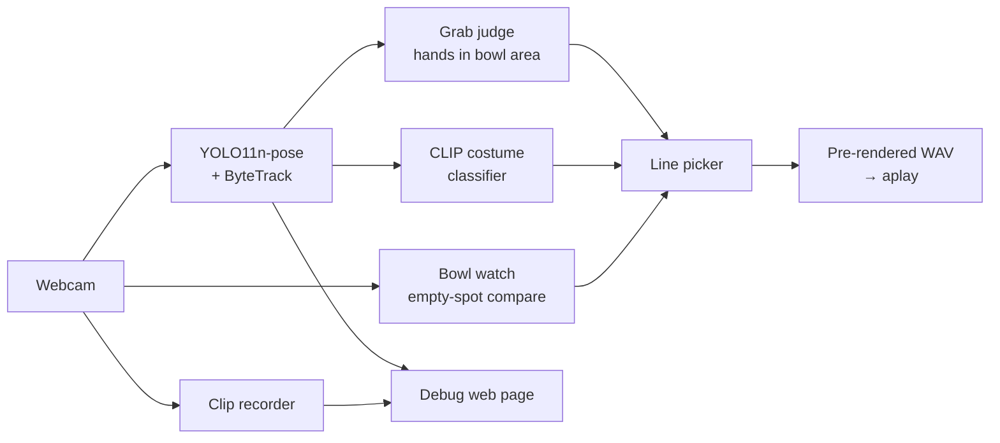

# 🎃 Candy Guardian

A Halloween porch guardian that watches the candy bowl through a webcam. When a trick-or-treater takes too much, it plays a spooky (but always kid-friendly) voice line asking them to put some back. It also greets visitors, raises an alarm if someone walks off with the whole bowl, and can record clips to watch later.

Everything runs locally in real time on a CPU: no cloud services, no GPU, and no text generated on the fly. Every line the system can say is written in advance and rendered to audio once, so nothing inappropriate can come out of the speaker.

## How it works



1. **Detect people.** YOLO11n-pose (exported to OpenVINO) finds people and their wrist and elbow keypoints. ByteTrack gives each person a stable ID across frames.
2. **Judge grabs.** You draw the bowl's outline once on the debug page. Each time a hand enters that area and leaves again counts as a grab. A person is flagged after too many grabs (`max_grabs`) or after keeping their hands in the bowl too long (`max_dwell_s`).
3. **Guess the costume.** CLIP ViT-B-32 compares each person against a fixed list of costumes (witch, vampire, superhero and so on), so the line can say "Hey, little witch…" instead of a generic line. It runs on its own thread and is optional.
4. **Watch the bowl.** The bowl area is compared to a photo of the empty spot. If it looks empty for most of a second, an alarm line plays and repeats until the bowl comes back.
5. **Speak.** Lines are picked at random (never the same one twice in a row) and played through `aplay`. All lines are rendered to WAV at startup with Piper, Kokoro or Chatterbox, then run through a `sox` effect chain for a spooky tone.

## Features

- **"Put it back" lines:** spoken when someone takes too much, optionally addressed to their costume.
- **Greetings:** "Happy Halloween, only take a few" shortly after someone arrives, once per group.
- **Bowl theft alarm:** fires within about a second of the bowl leaving its spot, with a thank-you line when it's returned. Alarm lines never cut each other off.
- **Three voice backends:** Piper (fast), Kokoro (natural), Chatterbox (most expressive, can clone a voice from a short sample you record).
- **Debug web page:** live annotated video, click-to-draw bowl outline, and a button to capture the empty spot.
- **Clip recording (optional):** saves a clip from 2 s before someone arrives until they leave, with a page for watching and deleting clips in the browser. Audio is optional and off by default (see [Privacy and legal](#privacy-and-legal)).

## Hardware

Built and tested on:

| Part | Used |
| --- | --- |
| Host | Proxmox VE, Ryzen 7 3800X, 32 GB RAM |
| Container | Unprivileged Debian 12 LXC, 4 cores, 6–10 GB RAM |
| Camera | Razer Kiyo (any UVC webcam should work) |
| Speaker | Any ALSA playback device (USB speaker, HDMI, 3.5 mm) |

No GPU is needed. Detection runs at about 12 fps on 4 CPU cores.

## Project layout

```
candy-guardian/
├── config.toml          # all settings
├── candy/
│   ├── main.py          # main loop: detection → judging → speech → recording
│   ├── config.py        # loads config.toml
│   ├── camera.py        # threaded webcam reader
│   ├── detector.py      # YOLO11n-pose + ByteTrack, hand keypoints
│   ├── grabs.py         # bowl outline and per-person grab counting
│   ├── bowlwatch.py     # bowl theft detection
│   ├── costume.py       # CLIP costume classifier
│   ├── lines.py         # every line the system can say
│   ├── voice.py         # TTS backends + sox effects + WAV cache
│   ├── render.py        # pre-render all lines (used for Chatterbox)
│   ├── player.py        # playback, cooldowns, interruption rules
│   ├── recorder.py      # clip recording and MP4 conversion
│   ├── audio.py         # optional microphone buffer for clips
│   └── stream.py        # debug web page and clips page
└── models/              # downloaded/exported models (not committed)
```

Generated at runtime and not committed: `roi.json` (bowl outline), `empty_spot.png`, `audio_cache/`, `clips/`.

## Setup

### 1. Container (Proxmox host)

```bash
pct create 210 local:vztmpl/debian-12-standard_12.7-1_amd64.tar.zst \
  --hostname candy-guardian --cores 4 --memory 6144 --swap 1024 \
  --rootfs local-lvm:32 --net0 name=eth0,bridge=vmbr0,ip=dhcp \
  --unprivileged 1 --features nesting=1 --onboot 1
```

Pass in the camera and **only the speaker's playback node**. Find the card numbers with `aplay -l` and `v4l2-ctl --list-devices`; gid 44 is `video` and gid 29 is `audio`.

```bash
pct set 210 --dev0 /dev/video0,gid=44
pct set 210 --dev1 /dev/snd/controlC1,gid=29
pct set 210 --dev2 /dev/snd/pcmC1D0p,gid=29
```

Don't pass the whole `/dev/snd` directory: that would include the webcam's microphone.

### 2. System packages and Python (inside the container)

```bash
apt install -y python3 python3-venv python3-dev build-essential \
  v4l-utils alsa-utils sox ffmpeg libgl1 libglib2.0-0 wget git espeak-ng
```

```bash
cd /opt/candy-guardian
python3 -m venv .venv
.venv/bin/pip install --upgrade pip wheel
.venv/bin/pip install torch torchvision --index-url https://download.pytorch.org/whl/cpu
.venv/bin/pip install ultralytics openvino "lap>=0.5.12" open_clip_torch piper-tts kokoro soundfile numpy
```

### 3. Models

```bash
mkdir -p models && cd models
../.venv/bin/yolo export model=yolo11n-pose.pt format=openvino imgsz=640
wget https://huggingface.co/rhasspy/piper-voices/resolve/main/en/en_US/ryan/high/en_US-ryan-high.onnx
wget https://huggingface.co/rhasspy/piper-voices/resolve/main/en/en_US/ryan/high/en_US-ryan-high.onnx.json
```

CLIP and Kokoro weights download automatically on first run.

### 4. Optional: Chatterbox voice

Chatterbox has conflicting dependencies, so it lives in its own venv and is only used to render the WAV cache:

```bash
python3 -m venv .venv-tts
.venv-tts/bin/pip install chatterbox-tts "setuptools<81"
```

Set `backend = "chatterbox"` in `[voice]`, then render every line (about 100 lines; slow on CPU, and safe to rerun since it resumes from the cache):

```bash
.venv-tts/bin/python -m candy.render
```

Rerun this whenever you add or change lines. Piper and Kokoro render automatically at startup.

### 5. First run and calibration

```bash
.venv/bin/python -m candy.main
```

Open `http://<container-ip>:8080`, then:

1. **Draw the bowl:** click its corners on the live image and press **Save bowl**.
2. **Capture the empty spot:** at night with the porch light on, remove the bowl, step out of view and press **Capture empty spot**.
3. **Set the theft threshold:** note the `bowl diff` number (top left) with the spot empty, the bowl full, and the bowl nearly empty. Set `empty_diff_max` in `[bowl_watch]` about a third of the way from the empty reading to the nearly-empty reading.
4. **Test it:** take three handfuls, then walk off with the bowl and bring it back.

### 6. Run as a service

`/etc/systemd/system/candy-guardian.service`:

```ini
[Unit]
Description=Candy Guardian
After=network.target sound.target
StartLimitIntervalSec=0

[Service]
User=candy
WorkingDirectory=/opt/candy-guardian
ExecStart=/opt/candy-guardian/.venv/bin/python -m candy.main
Environment=PYTHONFAULTHANDLER=1
Restart=on-failure
RestartSec=3

[Install]
WantedBy=multi-user.target
```

```bash
systemctl daemon-reload && systemctl enable --now candy-guardian
journalctl -u candy-guardian -f
```

## Configuration

Everything lives in `config.toml`. The settings you're most likely to tune:

| Section | Key | Default | What it does |
| --- | --- | --- | --- |
| `[grabs]` | `max_grabs` | `2` | Grabs allowed before the "put it back" line |
| `[grabs]` | `max_dwell_s` | `6.0` | Seconds of hands-in-bowl allowed |
| `[player]` | `global_cooldown_s` | `8.0` | Minimum gap between lines |
| `[voice]` | `backend` | `"chatterbox"` | `piper`, `kokoro` or `chatterbox` (Chatterbox needs step 4 first) |
| `[voice]` | `effect` | pitch/reverb chain | `sox` effects; keep the leading `gain -8` to avoid clipping |
| `[costume]` | `enabled` | `true` | Costume-specific lines via CLIP |
| `[greeting]` | `delay_s` | `1.0` | Seconds someone must be in view before the greeting |
| `[greeting]` | `cooldown_s` | `20.0` | People arriving within this window count as one group |
| `[bowl_watch]` | `empty_diff_max` | `10.0` | Theft threshold (calibrate, see above) |
| `[bowl_watch]` | `repeat_s` | `3.0` | Pause after an alarm line before repeating |
| `[recording]` | `enabled` | `true` | Save clips of visitors |
| `[recording]` | `keep_days` | `14` | Clips older than this are deleted at startup |
| `[audio]` | `enabled` | `false` | Record microphone audio into clips |

To change what it says, edit `candy/lines.py`. Keep lines short, silly and suitable for small kids.

## Web interface

| Page | What's there |
| --- | --- |
| `/` | Live annotated video (people, hands, grab counts, costume guesses, bowl status), bowl outline editor, **Capture empty spot** |
| `/clips` | Recorded clips, newest first, with playback and delete |

The pages have **no login**. Keep port 8080 on your LAN, put guests on a separate Wi-Fi network, and never forward the port on your router. To check in from outside, use Tailscale or a VPN.

## Privacy and legal

This records children, so it's built to keep as little as possible:

- **Local only.** Nothing is sent anywhere. Disable OpenVINO's usage telemetry with `.venv/bin/opt_in_out --opt_out`.
- **No audio by default.** The webcam's microphone isn't even passed into the container. In one-party-consent states like Idaho, recording conversations you aren't part of can be illegal, even on your own porch. If you enable `[audio]`, put up a clear "audio and video recording in progress" sign, and check your local laws.
- **Video clips are optional** and auto-delete after `keep_days`. Don't post clips of identifiable kids without their parents' permission.
- **Never commit `clips/`, `empty_spot.png` or `roi.json`.** The included `.gitignore` excludes them.
- **Put up a sign** either way. Something like "This bowl is guarded by a friendly robot ghost 👻 (video recording in progress)" works.

This isn't legal advice.

## Known limitations

- **Tracking resets:** if a kid is briefly hidden, they may get a new ID and their grab count starts over.
- **Fast or two-handed grabs** close to the camera can be miscounted. Tune `max_grabs`, `min_dip_s` and `merge_gap_s` while watching the debug page.
- **Costume guesses** are only as good as CLIP's view at night; low confidence falls back to generic lines.
- **Bowl theft** depends on the bowl looking different from the surface under it. A light-colored placemat under a dark bowl helps.
- **Someone standing over the empty spot** for a couple of seconds can trigger a false "thanks for returning it" line. The alarm resumes once they move.
- **Lighting changes** (daylight vs. porch light) mean recapturing the empty spot.

## Troubleshooting

| Symptom | Likely cause |
| --- | --- |
| `sox WARN … clipped` and silent audio | Missing `gain -8` at the start of the `effect` chain |
| Chatterbox `'NoneType' object is not callable` | Missing `pkg_resources`; install `"setuptools<81"` in `.venv-tts` |
| Main app crashes looking for Chatterbox | New lines weren't rendered; run `.venv-tts/bin/python -m candy.render` |
| Random segfaults, corrupted `.pyc`, odd typos like `Dalse` in library files | Unstable RAM on the host. Disable XMP/DOCP and PBO, run memtest86+, then rebuild `.venv` and the YOLO export |
| No sound | Wrong `device` in `[player]`; test with `aplay -D plughw:1,0 some.wav` |

## Built with

[Ultralytics YOLO11](https://github.com/ultralytics/ultralytics) · [OpenVINO](https://github.com/openvinotoolkit/openvino) · [OpenCLIP](https://github.com/mlfoundations/open_clip) · [Piper](https://github.com/rhasspy/piper) · [Kokoro](https://github.com/hexgrad/kokoro) · [Chatterbox](https://github.com/resemble-ai/chatterbox) · [SoX](https://sourceforge.net/projects/sox/) · [FFmpeg](https://ffmpeg.org/)

## License

No license chosen yet. Note that Ultralytics YOLO is licensed under AGPL-3.0, which affects how this project can be licensed and shared.
